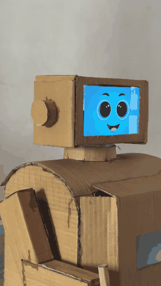
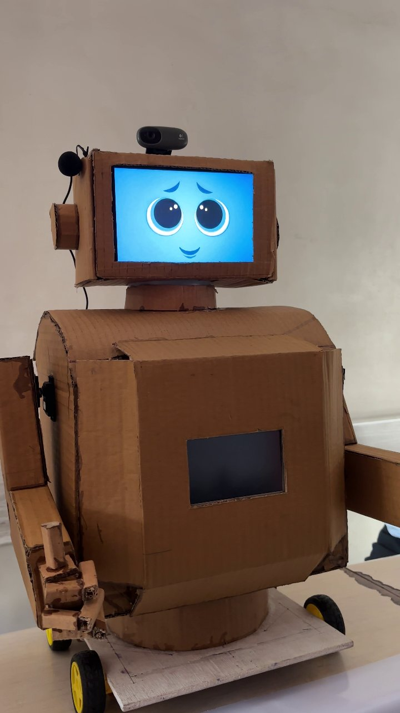
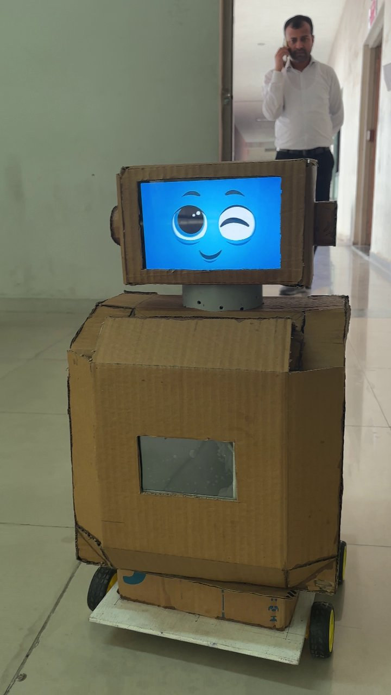
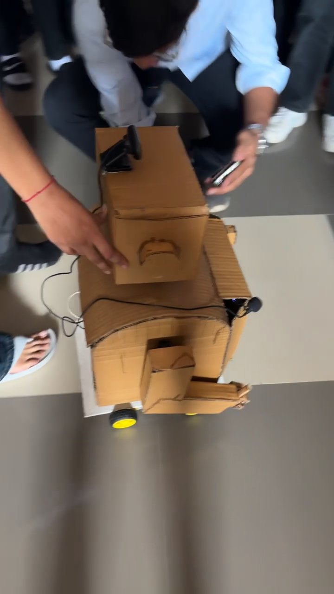

# Jerry — Voice-Interactive Autonomous Vision Robot

[](https://www.python.org/)
[](https://www.raspberrypi.com/)
[](https://opencv.org/)
[](https://pypi.org/project/RPi.GPIO/)
[](LICENSE)

<div align="center">



*Figure 1: Live physical prototype demonstrating animated expressive LCD eyes, speech lipsync, and pan-tilt head articulation.*

</div>

---

## 1. Executive Summary & Purpose

Physical robotic agents operating in unstructured domestic or educational environments must reconcile multi-modal sensor inputs—optical video streams, directional navigation commands, and actuator control loops—under strict edge compute constraints.

**Jerry** is an autonomous mobile robot built on a Raspberry Pi 4 that integrates:
- **Perception & Vision:** Real-time video frame capture and streaming via OpenCV and top-mounted optical webcam.
- **Auditory & Voice Interface:** Audio speech capture via head-mounted lavalier microphone, speech recognition, and expressive animated LCD facial feedback.
- **Differential Mobility:** Dual-channel DC motor propulsion using pulse-width modulation (PWM) via an L298N H-bridge driver.
- **Web Teleoperation Gateway:** A responsive, low-latency browser teleoperation interface (`index.html`) for manual override, joystick steering, and diagnostic telemetry.

---

## 2. Physical Hardware Architecture & Prototype

<div align="center">


&nbsp;

&nbsp;


*Figure 2: (Left) Front hardware profile showing Logitech webcam, microphone, animated LCD face, and articulated mechanical arm. (Center) Mobile chassis standing in testing corridor. (Right) Field teleoperation testing via mobile web controller.*

</div>

```mermaid
flowchart LR
    subgraph Compute ["Compute Core"]
        RPi["Raspberry Pi 4<br>(Linux Ubuntu / Pi OS)"]
    end

    subgraph Power ["Power Distribution"]
        Battery["Li-ion Battery Pack<br>(12V Motor Rail + 5V Logic Rail)"]
    end

    subgraph Actuation ["Mobility & Articulation"]
        L298N["L298N H-Bridge Driver"]
        MotorL["Left DC Drive Motor"]
        MotorR["Right DC Drive Motor"]
        ArmServo["Articulated Arm Servo"]
    end

    subgraph Sensors ["Perception & Telemetry"]
        Cam["Logitech Webcam (Optical Capture)"]
        Mic["Head Microphone (Audio Capture)"]
        LCD["LCD Facial Display (Emotional Feedback)"]
        WebUI["Web Teleoperation Client (Browser)"]
    end

    Battery -->|12V Motor Power| L298N
    Battery -->|5V USB-C| RPi
    RPi -->|BCM GPIO 17, 18, 22, 23| L298N
    RPi -->|PWM ENA: 27, ENB: 24 (1 kHz)| L298N
    L298N --> MotorL
    L298N --> MotorR
    RPi --> ArmServo
    Cam -->|USB Video Stream| RPi
    Mic -->|Audio Input Stream| RPi
    RPi -->|HDMI / SPI Display| LCD
    WebUI <-->|HTTP / Flask REST & MJPEG| RPi
```

### GPIO Pin Mapping (Broadcom / BCM Mode)

| Motor Channel | Signal Pin | BCM GPIO | Physical Header Pin | Function |
| :--- | :---: | :---: | :---: | :--- |
| **Left Motor** | `IN1` | `GPIO 17` | Pin 11 | Forward Direction Logic |
| **Left Motor** | `IN2` | `GPIO 18` | Pin 12 | Reverse Direction Logic |
| **Left Motor** | `ENA` | `GPIO 27` | Pin 13 | Speed Control (1 kHz PWM) |
| **Right Motor** | `IN3` | `GPIO 22` | Pin 15 | Forward Direction Logic |
| **Right Motor** | `IN4` | `GPIO 23` | Pin 16 | Reverse Direction Logic |
| **Right Motor** | `ENB` | `GPIO 24` | Pin 18 | Speed Control (1 kHz PWM) |

---

## 3. Software Architecture & Control Loops

- **`main.py`:** Flask HTTP camera capture microservice. Initializes optical video capture (`cv2.VideoCapture(0)`), acquires uncompressed frames, and exposes `/capture` endpoint for streaming.
- **`servo.py`:** Edge motor control server utilizing `RPi.GPIO`. Implements continuous 1 kHz PWM frequency modulation to adjust differential drive velocity during forward, reverse, turning, and pivoting maneuvers.
- **`index.html`:** Lightweight single-page teleoperation dashboard featuring touch/mouse navigation pads, speed regulators, and camera telemetry feedback.

---

## 4. Repository Structure

```
Robo/
├── docs/
│   └── assets/                         # Visual demonstration assets
│       ├── jerry_animation.gif         # 3-second looping facial & head movement GIF
│       ├── jerry_hardware_hero.jpg     # Front hardware profile with sensors
│       ├── jerry_hallway_mobile.jpg    # Full mobile stance photograph
│       └── jerry_teleop_demo.jpg       # Field teleoperation testing photograph
├── main.py                             # Camera video capture & streaming service
├── servo.py                            # GPIO PWM differential motor driver service
├── index.html                          # Web teleoperation interface & joystick
├── requirements.txt                    # Python dependencies (Flask, OpenCV)
├── .gitignore                          # Artifact exclusions
├── Battery Low.mp4                     # Telemetry audiovisual asset
├── LipSync.mp4                         # Conversational audiovisual asset
└── WhatsApp Video 2025-09-30...mp4     # Physical hardware prototype demonstration
```

---

## 5. Prerequisites & Hardware Setup

### Hardware Components
1. Raspberry Pi 4 Model B (2GB+ RAM).
2. L298N Dual H-Bridge Motor Driver Module.
3. 2× Geared DC Motors with chassis/wheels.
4. Optical Webcam (Logitech C270 / equivalent USB module).
5. Head-mounted audio microphone.
6. LCD Display for animated facial feedback.
7. External power supply (e.g., 2S/3S Li-ion pack) with common ground to Raspberry Pi.

### Software Installation

```bash
# Clone the repository onto the Raspberry Pi
git clone https://github.com/Anas18102004/Robo.git
cd Robo

# Create and activate virtual environment
python3 -m venv venv
source venv/bin/activate

# Install package dependencies
pip install -r requirements.txt
```

---

## 6. Execution & Operating Instructions

### 1. Launch Camera Capture Service

```bash
python main.py
```
*Initializes optical video stream on `http://<pi-ip-address>:5000/capture`.*

### 2. Launch Motor Actuation Controller

```bash
sudo python servo.py
```
*(Requires `sudo` permissions on Linux for direct memory-mapped GPIO access).*

### 3. Open Teleoperation Dashboard

Open your web browser and navigate to `http://<pi-ip-address>:5000` to control movement and observe visual telemetry.

---

## 7. License & Citation

Distributed under the **MIT License**.

```bibtex
@software{africawala2025jerryrobot,
  author = {Africawala, Mohammad Anas},
  title = {Jerry: Autonomous Vision and Physical Actuation Robot},
  year = {2025},
  publisher = {GitHub},
  url = {https://github.com/Anas18102004/Robo}
}
```
